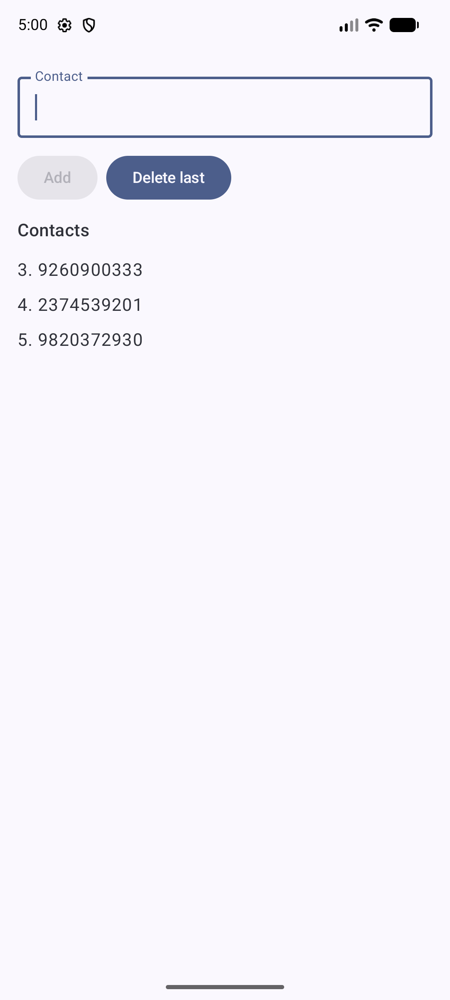
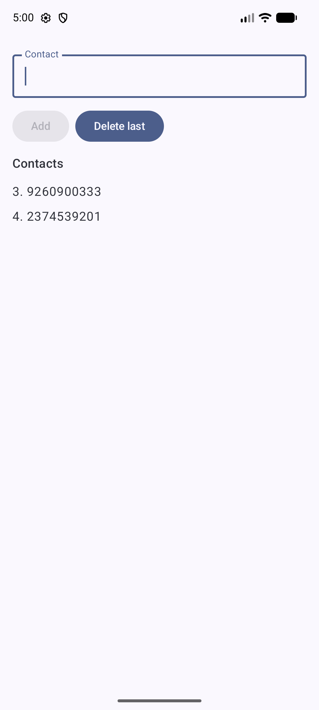

# Q1. In a contact search screen, the typed search text must survive process death. Use SavedStateHandle inside the ViewModel to preserve the search query string, and pass that saved state into a filtered Room database query to update the displayed list of contacts.

